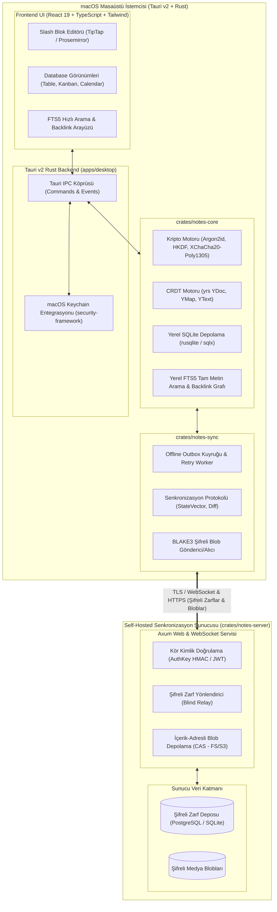
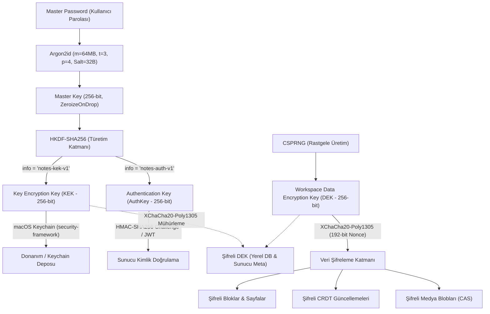
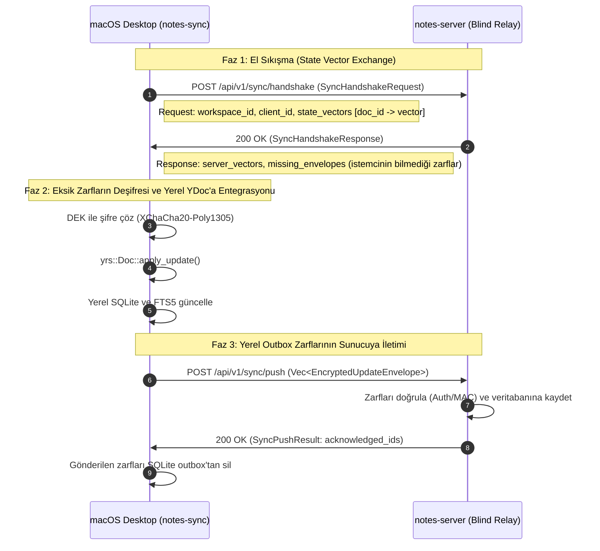
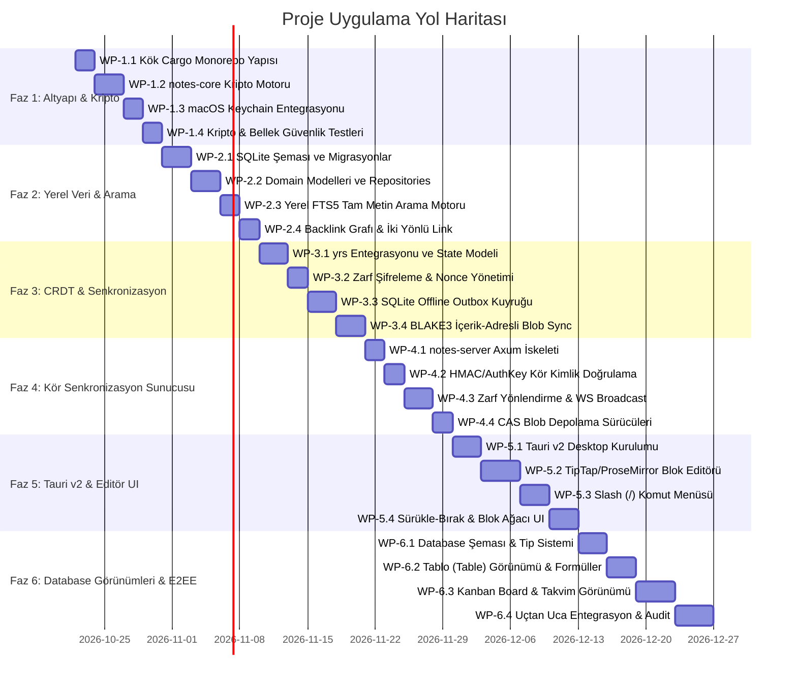

# Notes — Sistem Mimarisi ve Teknik Şartname

Bu doküman, macOS üzerinde çalışan, Rust ile yazılmış, **local-first**, **uçtan uca şifreli (E2EE - Zero-Knowledge)** ve **self-hosted Cloud API senkronizasyon** destekli Notion benzeri not alma uygulamasının eksiksiz sistem mimarisini ve uygulama yol haritasını tanımlar.

---

## 1. Hedef ve Bağlam

### 1.1 Temel Hedefler ve Prensipler
- **Local-First & Sıfır Gecikme:** Kullanıcı verileri ilk olarak her zaman yerel makinede (SQLite) depolanır. Okuma, yazma ve tam metin arama işlemleri ağ bağlantısı gerektirmeksizin milisaniye altı hızlarda çalışır.
- **Uçtan Uca Şifreleme (Zero-Knowledge E2EE):** İstemciden çıkan tüm içerikler (blok metinleri, başlıklar, doküman ağacı, dosya ekleri) istemcide şifrelenir. Senkronizasyon sunucusu yalnızca şifreli zarfları (`EncryptedUpdateEnvelope`) ve şifreli medya bloblarını saklayan bir "kör aktarıcı"dır (blind relay).
- **Gelişmiş Blok Editörü & Database Görünümleri:** Notion benzeri slash (`/`) komutları, zengin metin blokları, sürükle-bırak blok hiyerarşisi, iki yönlü bağlantılar (`[[sayfa]]` backlink grafı) ve yapılandırılmış veri tabloları (Tablo, Kanban Board, Takvim, Liste, Galeri).
- **Çatışmasız Senkronizasyon (CRDT):** Yrs (Rust Yjs portu) CRDT motoru sayesinde çoklu cihaz üzerinde eşzamanlı veya çevrimdışı yapılan değişiklikler deterministik ve veri kaybı olmaksızın birleştirilir.
- **macOS Yerel Entegrasyonu:** Tauri v2 masaüstü kabuğu, macOS Keychain (`security-framework`) üzerinden donanım destekli anahtar yönetimi ve yerel işletim sistemi bildirimleri.

### 1.2 Sistem Mimarisi Genel Bakış



---

## 2. Monorepo Dizin Ağacı ve Kök Yapısı

### 2.1 Monorepo Dizin Ağacı

```
notes/
├── .agents/                      # Antigravity subagent tanımları
│   └── agents/
│       ├── architect.md
│       ├── coder.md
│       ├── explorer.md
│       └── reviewer.md
├── .claude/                      # Claude / CLI agent orkestrasyonu
├── .gitignore                    # Tam kapsamlı git ignore tanımları
├── Cargo.lock
├── Cargo.toml                    # Root Workspace Cargo manifestosu
├── README.md
├── docs/                         # Mimari dokümanlar ve şartnameler
│   └── ARCHITECTURE.md
├── crates/
│   ├── notes-core/               # Çekirdek domain, kripto, sqlite, yrs CRDT, FTS5
│   │   ├── Cargo.toml
│   │   ├── src/
│   │   │   ├── lib.rs
│   │   │   ├── crypto/           # Argon2id, HKDF, XChaCha20-Poly1305, zeroize
│   │   │   ├── db/               # SQLite şeması, migrasyonlar, bağlantı havuzu
│   │   │   ├── models/           # Page, Block, Database, Property veri modelleri
│   │   │   ├── crdt/             # yrs döküman entegrasyonu ve update mantığı
│   │   │   ├── search/           # FTS5 indeksleme ve arama servisleri
│   │   │   └── keychain/         # macOS Keychain API sarmalayıcısı
│   │   └── tests/
│   ├── notes-sync/               # Senkronizasyon protokolü, state vector, outbox
│   │   ├── Cargo.toml
│   │   ├── src/
│   │   │   ├── lib.rs
│   │   │   ├── protocol/         # SyncHandshake, EncryptedUpdateEnvelope
│   │   │   ├── outbox/           # Çevrimdışı mutasyon kuyruğu ve dispatch worker
│   │   │   ├── client/           # HTTP/WebSocket istemcisi
│   │   │   └── blob/             # BLAKE3 hashli şifreli dosya transferi
│   │   └── tests/
│   └── notes-server/             # Self-hosted kör sunucu (Axum, blind relay)
│       ├── Cargo.toml
│       ├── src/
│       │   ├── main.rs
│       │   ├── config.rs         # Sunucu yapılandırması ve çevre değişkenleri
│       │   ├── routes/           # Auth, sync, blob API rotaları
│       │   ├── auth/             # HMAC/JWT doğrulaması
│       │   ├── storage/          # Zarf DB ve CAS blob sürücüleri
│       │   └── ws/               # Gerçek zamanlı WebSocket broadcast kanalları
│       └── tests/
└── apps/
    └── desktop/                  # Tauri v2 Masaüstü Uygulaması
        ├── Cargo.toml
        ├── package.json
        ├── tsconfig.json
        ├── vite.config.ts
        ├── src-tauri/            # Tauri v2 Rust backend
        │   ├── Cargo.toml
        │   ├── tauri.conf.json
        │   ├── build.rs
        │   └── src/
        │       ├── main.rs
        │       └── commands/     # Tauri IPC komut handler'ları
        └── src/                  # React 19 Frontend
            ├── main.tsx
            ├── App.tsx
            ├── components/       # Slash editör, sidebar, database görünümleri
            ├── hooks/            # Tauri IPC, CRDT ve FTS hook'ları
            ├── stores/           # Zustand yerel UI state
            └── types/            # TypeScript domain modelleri
```

### 2.2 Kök `Cargo.toml` Yapısı

```toml
[workspace]
resolver = "2"
members = [
    "crates/notes-core",
    "crates/notes-sync",
    "crates/notes-server",
    "apps/desktop/src-tauri",
]

[workspace.package]
version = "0.1.0"
edition = "2024"
authors = ["Notes Contributors"]
license = "MIT OR Apache-2.0"

[workspace.dependencies]
# Ortak Kriptografi
argon2 = "0.5"
chacha20poly1305 = "0.10"
hkdf = "0.12"
sha2 = "0.10"
blake3 = "1.5"
zeroize = { version = "1.8", features = ["derive", "zeroize_derive"] }
rand = "0.8"
subtle = "2.6"

# CRDT
yrs = "0.21"

# Serileştirme & Tipler
serde = { version = "1.0", features = ["derive"] }
serde_json = "1.0"
uuid = { version = "1.10", features = ["v4", "v7", "serde"] }
chrono = { version = "0.4", features = ["serde"] }

# Asenkron Çalışma Zamanı
tokio = { version = "1.40", features = ["full"] }
tokio-util = "0.7"
futures = "0.3"
async-trait = "0.1"

# Veritabanı (İstemci & Sunucu)
rusqlite = { version = "0.32", features = ["bundled", "vtab", "fts5"] }
sqlx = { version = "0.8", features = ["runtime-tokio", "tls-rustls", "postgres", "sqlite", "uuid", "chrono"] }

# Web & Ağ
axum = { version = "0.7", features = ["ws"] }
reqwest = { version = "0.12", features = ["json", "stream"] }
tower = "0.5"
tower-http = { version = "0.5", features = ["trace", "cors"] }

# Loglama & Hata Yönetimi
tracing = "0.1"
tracing-subscriber = { version = "0.3", features = ["env-filter"] }
thiserror = "1.0"
anyhow = "1.0"

# macOS Entegrasyonu
security-framework = "2.11"
```

---

## 3. Kriptografi Mimarisi (Zero-Knowledge E2EE)

Sistemin güvenlik modeli **Sıfır-Bilgi (Zero-Knowledge)** ilkesine dayanır. Sunucu hiçbir zaman kullanıcının şifresini, anahtarlarını veya açık veri içeriğini görmez.



### 3.1 Anahtar Türetme ve Hiyerarşi
1. **Master Password & Argon2id:**
   - Kullanıcı parolası yerel makinede `Argon2id` fonksiyonu ile işlenir.
   - Parametreler: Bellek Maliyeti: 64 MB (`m=65536`), İterasyon Sayısı: 3 (`t=3`), Paralellik: 4 iş parçacığı (`p=4`), Tuz: 32 bayt CSPRNG.
   - Çıktı: 256-bit `MasterKey`.
2. **HKDF-SHA256 ile Ayrıştırma (RFC 5869):**
   - Tek bir `MasterKey` doğrudan veri şifrelemede kullanılmaz. HKDF-Extract ve HKDF-Expand adımlarıyla iki ayrı anahtara ayrıştırılır:
     - `KEK` (Key Encryption Key): `HKDF-Expand(MasterKey, info="notes-kek-v1", len=32)`
     - `AuthKey` (Authentication Key): `HKDF-Expand(MasterKey, info="notes-auth-v1", len=32)`
3. **Workspace Data Encryption Key (DEK):**
   - Her çalışma alanı (Workspace) için bağımsız, rastgele 256-bit bir `DEK` üretilir.
   - `DEK`, `KEK` kullanılarak `XChaCha20-Poly1305` ile şifrelenir (`EncryptedDEK`).
   - `EncryptedDEK` yerel veritabanında saklanır; kullanıcının cihazları arasında parola ile şifresi çözülerek paylaşılabilir.
4. **Zarf Şifrelemesi (Envelope Encryption) & XChaCha20-Poly1305:**
   - CRDT güncellemeleri, blok verileri ve ekler `DEK` ile şifrelenir.
   - `XChaCha20-Poly1305`, 192-bit nonce boyutu sayesinde rastgele üretilen nonce'larda çakışma riskini (birthday bound) ortadan kaldırır.
   - Bütünlük ve kimlik doğrulama her zarfta Poly1305 MAC etiketi ile garanti edilir.

### 3.2 Bellek Güvenliği (`Zeroize`)
- Hassas anahtarları barındıran tüm Rust yapıları `zeroize::Zeroize` ve `zeroize::ZeroizeOnDrop` trait'lerini uygular.
- İşlem tamamlandığında veya nesne scope dışına çıktığında RAM'deki ilgili bellek alanı sıfırlanır (volatile memset).
- Parola girişi ve ara türetim tamponları `secrecy::SecretBox` veya `secrecy::SecretVec` ile korunur.

```rust
use zeroize::{Zeroize, ZeroizeOnDrop};

#[derive(Zeroize, ZeroizeOnDrop)]
pub struct MasterKey([u8; 32]);

#[derive(Zeroize, ZeroizeOnDrop)]
pub struct DataEncryptionKey([u8; 32]);

#[derive(Zeroize, ZeroizeOnDrop)]
pub struct KeyEncryptionKey([u8; 32]);
```

### 3.3 macOS Keychain Entegrasyonu
- Masaüstü istemcisinde kullanıcı oturum açtığında, `KEK` değeri `security-framework` crate'i aracılığıyla macOS Keychain Access içerisine kaydedilir.
- Kullanıcı her uygulama açılışında ana parolayı yeniden girmek yerine Touch ID / macOS oturum kimliği ile `KEK`'e erişebilir.

---

## 4. CRDT (`yrs`) ve Senkronizasyon Protokolü

### 4.1 `yrs` Tabanlı Çatışmasız Replikasyon
- Not hiyerarşisi ve zengin metin içeriği `yrs::Doc` üzerinde saklanır.
- Sayfa meta verileri ve blok ağacı CRDT `YMap` ve `YArray` yapılarıyla temsil edilir.
- Blok içi zengin metinler `YText` üzerinden karakter bazlı operasyonlarla yönetilir. Bu sayede eşzamanlı düzenlemelerde veri kaybı yaşanmaz.

### 4.2 İki Adımlı Durum Vektörü Değişimi (Handshake Protocol)



### 4.3 Veri Yapıları: `EncryptedUpdateEnvelope` ve `Handshake`

```rust
use serde::{Deserialize, Serialize};
use uuid::Uuid;

#[derive(Debug, Clone, Serialize, Deserialize)]
pub struct EncryptedUpdateEnvelope {
    pub id: Uuid,                  // UUIDv7 (zaman sıralı)
    pub workspace_id: Uuid,
    pub doc_id: Uuid,              // İlgili Sayfa / YDoc ID
    pub client_id: u64,            // yrs client identifier
    pub clock_sequence: u64,       // İstemci bazlı artan sıra numarası
    pub nonce: [u8; 24],           // XChaCha20 192-bit nonce
    pub ciphertext: Vec<u8>,       // Şifrelenmiş yrs update binary verisi + Poly1305 tag
    pub created_at: i64,           // Unix epoch timestamp (milisaniye)
}

#[derive(Debug, Clone, Serialize, Deserialize)]
pub struct SyncHandshakeRequest {
    pub workspace_id: Uuid,
    pub client_id: Uuid,
    /// Her dökümanın yerel yrs StateVector binary gösterimi
    pub state_vectors: Vec<DocStateVector>,
}

#[derive(Debug, Clone, Serialize, Deserialize)]
pub struct DocStateVector {
    pub doc_id: Uuid,
    pub state_vector: Vec<u8>,
}

#[derive(Debug, Clone, Serialize, Deserialize)]
pub struct SyncHandshakeResponse {
    pub workspace_id: Uuid,
    /// Sunucuda bulunan ancak istemcinin durum vektöründe eksik olan zarflar
    pub missing_envelopes: Vec<EncryptedUpdateEnvelope>,
}
```

### 4.4 Çevrimdışı (Offline-First) Outbox Kuyruğu
- Cihaz çevrimdışıyken yapılan tüm düzenlemeler yerel SQLite veritabanındaki `sync_outbox` tablosuna atomik olarak yazılır.
- Arka planda çalışan `SyncWorker`:
  1. Ağ bağlantısını izler (heartbeat / WebSocket ping).
  2. Bağlantı sağlandığında `sync_outbox` kuyruğundaki zarfları katı FIFO sıralamasıyla (`ORDER BY created_at ASC, id ASC` - UUIDv7 ile deterministik sıra) paketleyerek sunucuya iletir.
  3. Başarısız isteklerde exponential backoff (üssel geri çekilme) stratejisi uygular.
  4. Sunucu `ACK` döndüğünde kuyruktaki kayıtları kaldırır.

### 4.5 İçerik-Adresli Şifreli Blob Depolama (CAS)
- Resimler, videolar, ses kayıtları ve PDF ekleri doğrudan SQLite veya CRDT güncellemeleri içine gömülmez.
- Deterministik içerik-adresli tekilleştirme (deduplication) için sentetik nonce türetimi kullanılır:
  1. Ham dosya özeti: `raw_hash = blake3(raw_bytes)`
  2. Deterministik 24-bayt nonce: `nonce = HKDF-SHA256(DEK, salt=raw_hash, info="notes-blob-nonce-v1")[0..24]`
  3. Simetrik şifreleme: `ciphertext = XChaCha20-Poly1305(raw_bytes, DEK, nonce)`
  4. Şifreli içerik adresi: `blob_hash = blake3(ciphertext)`
- İstemci `POST /api/v1/blobs/:blob_hash` endpoint'ine şifreli gövdeyi gönderir.
- Sunucu içeriği bilmeden yalnızca hash doğrulaması yaparak blobu disk/S3 üzerinde saklar. Aynı içeriğe sahip dosyalar aynı çalışma alanı DEK'i altında her zaman aynı `blob_hash` değerini ürettiğinden, mükerrer dosyalar (deduplication) içerik-adresli yapı sayesinde tekil olarak depolanır.

---

## 5. Veri Modelleri, Yerel SQLite Şeması ve Yerel FTS5

### 5.1 Çekirdek Rust Veri Modelleri

```rust
use serde::{Deserialize, Serialize};
use uuid::Uuid;
use chrono::{DateTime, Utc};

#[derive(Debug, Clone, Serialize, Deserialize)]
pub struct Page {
    pub id: Uuid,
    pub workspace_id: Uuid,
    pub parent_page_id: Option<Uuid>,
    pub title: String,
    pub icon: Option<String>,
    pub cover_image: Option<String>,
    pub is_database: bool,
    pub is_pinned: bool,
    pub is_deleted: bool,
    pub created_at: DateTime<Utc>,
    pub updated_at: DateTime<Utc>,
}

#[derive(Debug, Clone, Serialize, Deserialize, PartialEq, Eq)]
#[serde(rename_all = "snake_case")]
pub enum BlockType {
    Paragraph,
    Heading1,
    Heading2,
    Heading3,
    BulletListItem,
    NumberedListItem,
    TodoItem,
    CodeBlock,
    Quote,
    Callout,
    Divider,
    Image,
    File,
    DatabaseInline,
}

#[derive(Debug, Clone, Serialize, Deserialize)]
pub struct Block {
    pub id: Uuid,
    pub page_id: Uuid,
    pub parent_block_id: Option<Uuid>,
    pub block_type: BlockType,
    pub content: serde_json::Value,     // TipTap JSON / Zengin metin formatı
    pub properties: serde_json::Value,  // Renk, hizalama, dil vb.
    pub sort_order: f64,                // Fractional indexing (LSeq)
    pub created_at: DateTime<Utc>,
    pub updated_at: DateTime<Utc>,
}

#[derive(Debug, Clone, Serialize, Deserialize)]
#[serde(rename_all = "snake_case")]
pub enum PropertyType {
    Text,
    Number,
    Select,
    MultiSelect,
    Date,
    Checkbox,
    Url,
    Email,
    Relation,
    CreatedTime,
    LastEditedTime,
}

#[derive(Debug, Clone, Serialize, Deserialize)]
pub struct DatabaseSchema {
    pub id: Uuid,
    pub page_id: Uuid,
    pub properties: Vec<DatabasePropertyDefinition>,
}

#[derive(Debug, Clone, Serialize, Deserialize)]
pub struct DatabasePropertyDefinition {
    pub id: String,
    pub name: String,
    pub property_type: PropertyType,
    pub options: Option<serde_json::Value>, // Select seçenekleri vb.
}

#[derive(Debug, Clone, Serialize, Deserialize)]
#[serde(rename_all = "snake_case")]
pub enum DatabaseViewType {
    Table,
    Board,
    Calendar,
    List,
    Gallery,
}

#[derive(Debug, Clone, Serialize, Deserialize)]
pub struct DatabaseView {
    pub id: Uuid,
    pub database_id: Uuid,
    pub title: String,
    pub view_type: DatabaseViewType,
    pub filter_groups: serde_json::Value,
    pub sort_rules: serde_json::Value,
    pub visible_properties: Vec<String>,
}
```

### 5.2 Yerel SQLite İlişkisel Şeması

```sql
-- Çalışma Alanları (Yerel)
CREATE TABLE IF NOT EXISTS workspaces (
    id TEXT PRIMARY KEY NOT NULL,
    name TEXT NOT NULL,
    encrypted_dek BLOB NOT NULL,
    dek_nonce BLOB NOT NULL,
    created_at INTEGER NOT NULL
);

-- Sayfalar
CREATE TABLE IF NOT EXISTS pages (
    id TEXT PRIMARY KEY NOT NULL,
    workspace_id TEXT NOT NULL,
    parent_page_id TEXT,
    title TEXT NOT NULL,
    icon TEXT,
    cover_image TEXT,
    is_database INTEGER NOT NULL DEFAULT 0,
    is_pinned INTEGER NOT NULL DEFAULT 0,
    is_deleted INTEGER NOT NULL DEFAULT 0,
    created_at INTEGER NOT NULL,
    updated_at INTEGER NOT NULL,
    FOREIGN KEY(workspace_id) REFERENCES workspaces(id) ON DELETE CASCADE,
    FOREIGN KEY(parent_page_id) REFERENCES pages(id) ON DELETE SET NULL
);
CREATE INDEX IF NOT EXISTS idx_pages_workspace ON pages(workspace_id);
CREATE INDEX IF NOT EXISTS idx_pages_parent ON pages(parent_page_id);

-- Bloklar (Yerel materialize edilmiş görünüm)
CREATE TABLE IF NOT EXISTS blocks (
    id TEXT PRIMARY KEY NOT NULL,
    page_id TEXT NOT NULL,
    parent_block_id TEXT,
    block_type TEXT NOT NULL,
    content_json TEXT NOT NULL,
    properties_json TEXT NOT NULL DEFAULT '{}',
    sort_order REAL NOT NULL,
    created_at INTEGER NOT NULL,
    updated_at INTEGER NOT NULL,
    FOREIGN KEY(page_id) REFERENCES pages(id) ON DELETE CASCADE
);
CREATE INDEX IF NOT EXISTS idx_blocks_page_sort ON blocks(page_id, sort_order);

-- İki Yönlü Bağlantılar (Backlinks & Wikilinks)
CREATE TABLE IF NOT EXISTS page_links (
    id TEXT PRIMARY KEY NOT NULL,
    source_page_id TEXT NOT NULL,
    target_page_id TEXT NOT NULL,
    source_block_id TEXT,
    anchor_text TEXT,
    created_at INTEGER NOT NULL,
    FOREIGN KEY(source_page_id) REFERENCES pages(id) ON DELETE CASCADE,
    FOREIGN KEY(target_page_id) REFERENCES pages(id) ON DELETE CASCADE
);
CREATE INDEX IF NOT EXISTS idx_links_target ON page_links(target_page_id);
CREATE INDEX IF NOT EXISTS idx_links_source ON page_links(source_page_id);

-- Sayfa Etiketleri (Tags)
CREATE TABLE IF NOT EXISTS page_tags (
    page_id TEXT NOT NULL,
    tag TEXT NOT NULL,
    PRIMARY KEY(page_id, tag),
    FOREIGN KEY(page_id) REFERENCES pages(id) ON DELETE CASCADE
);
CREATE INDEX IF NOT EXISTS idx_tags_tag ON page_tags(tag);

-- Senkronizasyon Kuyruğu (Offline Outbox)
-- Kuyruk tüketiminde katı FIFO sıralaması (created_at ASC, id ASC) garanti edilir.
-- id kolonu UUIDv7 (zaman sıralı ve monoton artan) olduğundan, aynı milisaniyedeki kayıtlarda da deterministik FIFO korunur.
CREATE TABLE IF NOT EXISTS sync_outbox (
    id TEXT PRIMARY KEY NOT NULL,          -- UUIDv7 (zaman sıralı ve monoton artan)
    workspace_id TEXT NOT NULL,
    doc_id TEXT NOT NULL,
    envelope_bytes BLOB NOT NULL,          -- EncryptedUpdateEnvelope serileştirilmiş hali
    retry_count INTEGER NOT NULL DEFAULT 0,
    last_error TEXT,
    created_at INTEGER NOT NULL            -- Unix epoch milisaniye
);
CREATE INDEX IF NOT EXISTS idx_outbox_fifo ON sync_outbox(created_at ASC, id ASC);

-- FTS5 Tam Metin Arama Sanal Tablosu
CREATE VIRTUAL TABLE IF NOT EXISTS fts_blocks USING fts5(
    block_id UNINDEXED,
    page_id UNINDEXED,
    page_title,
    plain_text,
    tokenize = 'unicode61 remove_diacritics 2'
);
```

### 5.3 Şifreli Veride Yerel FTS5 İndeksleme Stratejisi
1. **İkili Veri Akışı:**
   - Şifrelenmiş veri (`EncryptedUpdateEnvelope`) sunucuya gönderilir ve sunucudan alınır.
   - Yerel makinede zarf `DEK` ile çözülerek açık blok metni elde edilir.
2. **Yerel SQLite FTS5 İndeksi:**
   - Deşifre edilen açık metin blokları (`plain_text`) ve sayfa başlığı (`page_title`), yerel SQLite `fts_blocks` tablosuna eklenir / güncellenir.
   - `fts_blocks` tablosu asla sunucuya yüklenmez ve harici ağa açılmaz.
3. **Güvenlik Güvencesi:**
   - Diskteki SQLite dosyası macOS FileVault tam disk şifrelemesi ve uygulama bazlı SQLite dosya izinleri (`0600`) ile korunur.
   - Sıfır-Bilgi mimarisi bozulmadan kullanıcının yerelinde milisaniyelik prefix, snippet ve boolean tam metin aramaları gerçekleştirilir.

---

## 6. Sıralı Uygulama İş Paketleri (Faz 1 — Faz 6)

Tüm geliştirme süreci 6 ana faz ve 24 atomik iş paketine (`WP-1.1` - `WP-6.4`) ayrılmıştır.



### Faz 1: Monorepo Altyapısı ve Çekirdek Kripto
- **`WP-1.1: Kök Cargo Monorepo ve Workspace Yapılandırması`**
  - Kök `Cargo.toml` dosyasının, workspace üyelerinin (`notes-core`, `notes-sync`, `notes-server`, `apps/desktop/src-tauri`) ve ortak bağımlılık sürümlerinin tanımlanması.
- **`WP-1.2: notes-core Kripto Motoru (Argon2id, HKDF, XChaCha20-Poly1305)`**
  - Paroladan anahtar türetme (Argon2id), KEK ve AuthKey ayrıştırması (HKDF-SHA256) ve AEAD şifreleme/deşifreleme yardımcılarının yazılması.
- **`WP-1.3: macOS Keychain Entegrasyonu (security-framework)`**
  - `security-framework` kullanılarak KEK'in macOS Keychain üzerinde güvenli saklanması, okunması ve silinmesi.
- **`WP-1.4: Kripto Birim ve Bellek Güvenlik Testleri`**
  - Bilinen test vektörleri (RFC vectors) ile şifreleme testleri; `zeroize::ZeroizeOnDrop` bellek sıfırlama doğrulama testleri.

### Faz 2: Yerel Veri Katmanı, SQLite ve FTS5 Arama
- **`WP-2.1: SQLite Veritabanı Şeması ve Migrasyon Sistemi`**
  - `workspaces`, `pages`, `blocks`, `page_links`, `page_tags`, `sync_outbox` tablolarını oluşturan gömülü SQL migrasyonlarının hazırlanması.
- **`WP-2.2: Domain Modelleri ve Repository Katmanı`**
  - Rust domain modelleri (`Page`, `Block`, `DatabaseSchema`) ve SQLite CRUD işlemlerini yürüten repository katmanı.
- **`WP-2.3: Yerel FTS5 Tam Metin Arama Motoru`**
  - SQLite FTS5 sanal tablosunun yönetimi, blok değişikliklerinde anlık indeks güncelleme ve hızlı metin arama sorguları.
- **`WP-2.4: İki Yönlü Bağlantı (Backlink) ve Wikilink Çözümleme`**
  - Blok içerisindeki `[[sayfa-adi]]` bağlantılarının otomatik tespiti, `page_links` tablosuna yazılması ve hedef sayfanın gelen bağlantılar (backlinks) listesinin çıkarılması.

### Faz 3: CRDT (`yrs`) ve Çevrimdışı Outbox Senkronizasyon Çekirdeği
- **`WP-3.1: yrs Döküman ve State Modeli Entegrasyonu`**
  - `yrs::Doc` üzerinde sayfa meta verileri ve blok hiyerarşisinin modellenmesi; binary update üretme ve uygulama akışları.
- **`WP-3.2: Şifreli Zarf (EncryptedUpdateEnvelope) ve Nonce Yönetimi`**
  - `yrs` binary güncellemelerinin DEK ile şifrelenip `EncryptedUpdateEnvelope` zarfı haline getirilmesi; UUIDv7 ve artan sayaç sıralaması.
- **`WP-3.3: SQLite Offline Outbox Kuyruğu ve Retry Yöneticisi`**
  - Çevrimdışı yapılan mutasyonların `sync_outbox` tablosuna yazılması, ağ geri geldiğinde toplu iletim ve ACK sonrası temizlik döngüsü.
- **`WP-3.4: BLAKE3 İçerik-Adresli Şifreli Medya Blob Senkronizasyonu`**
  - Dosya eklerinin DEK ile şifrelenmesi, BLAKE3 hash'i ile adreslenmesi ve talep üzerine (on-demand) asenkron indirme/yükleme modülü.

### Faz 4: Self-Hosted Kör Senkronizasyon Sunucusu (`crates/notes-server`)
- **`WP-4.1: Axum Sunucu İskeleti ve Yapılandırma Modülü`**
  - `crates/notes-server` crate'inde Axum REST & WebSocket sunucu altyapısı, CORS, tracing ve çevre değişkeni yapılandırması.
- **`WP-4.2: AuthKey / HMAC Tabanlı Kör Kimlik Doğrulama`**
  - Sunucunun kullanıcının ana parolasını bilmeden yalnızca `AuthKey` üzerinden meydan okuma-yanıt (challenge-response) veya JWT ile kimlik doğrulaması.
- **`WP-4.3: Şifreli Zarf Yönlendirme (Blind Relay) ve WebSocket Broadcast`**
  - İstemcilerden gelen `EncryptedUpdateEnvelope` paketlerinin saklanması, eksik durum vektörlerine göre dağıtımı ve bağlı istemcilere gerçek zamanlı WebSocket yayını.
- **`WP-4.4: CAS Blob Depolama Sürücüleri (Yerel Disk & S3 Uyumlu)`**
  - İçerik-adresli şifreli medya bloblarının yerel dosya sisteminde veya S3 uyumlu depolama alanlarında saklanmasını sağlayan soyutlama katmanı.

### Faz 5: macOS Masaüstü Uygulaması (Tauri v2) ve Blok Editör UI
- **`WP-5.1: Tauri v2 Masaüstü Kabuğu ve IPC Köprüsü`**
  - `apps/desktop` dizininde Tauri v2 projesinin başlatılması, pencere yönetimi, menü çubuğu ve Rust backend ile React frontend arasındaki typed IPC komutları.
- **`WP-5.2: React 19 Blok Editörü Çekirdeği (TipTap / ProseMirror Entegrasyonu)`**
  - Zengin metin bloklarının oluşturulması, klavye kısayolları ve `notes-core` CRDT state'i ile anlık senkronizasyonu.
- **`WP-5.3: Slash (/) Komut Menüsü ve Blok Dönüşümleri`**
  - `/` tuşuna basıldığında açılan kayan menü (Başlıklar, Listeler, Kod Bloğu, Alıntı, Tablo, Çağrı Kutusu vb.) ve dinamik blok tipi dönüşümleri.
- **`WP-5.4: Sürükle-Bırak Hiyerarşisi ve Sayfa Gezinti Ağacı`**
  - Sayfa içi blokların dikey sürükle-bırak ile yeniden sıralanması (Fractional Indexing) ve sol kenar çubuğunda hiyerarşik sayfa ağacı gezintisi.

### Faz 6: Notion Benzeri Database Görünümleri, E2EE Blob Entegrasyonu ve Kararlılık
- **`WP-6.1: Database Şeması, Özel Özellikler ve Tip Sistemi UI`**
  - Sayfayı veritabanına dönüştürme, özel sütun/özellik ekleme (Metin, Sayı, Seçim, Çoklu Seçim, Tarih, Onay Kutusu, İlişki).
- **`WP-6.2: Dinamik Tablo (Table) Görünümü, Filtreleme ve Sıralama`**
  - Satır/sütun tabanlı tablo görünümü, çoklu filtreleme kuralları, sıralama mantığı ve formül/özet hesaplamaları.
- **`WP-6.3: Kanban (Board) ve Takvim (Calendar) Görünümleri`**
  - Seçim özelliğine göre gruplanmış sürüklenebilir Kanban kartları ve tarih özelliğine bağlı dinamik takvim görünümü.
- **`WP-6.4: Uçtan Uca Entegrasyon, Kriptografik Denetim ve Performans Optimizasyonu`**
  - Tüm istemci-sunucu akışlarının entegrasyon testleri, bellek sızıntısı denetimleri, macOS uygulama paketleme ve performans profilleme.
